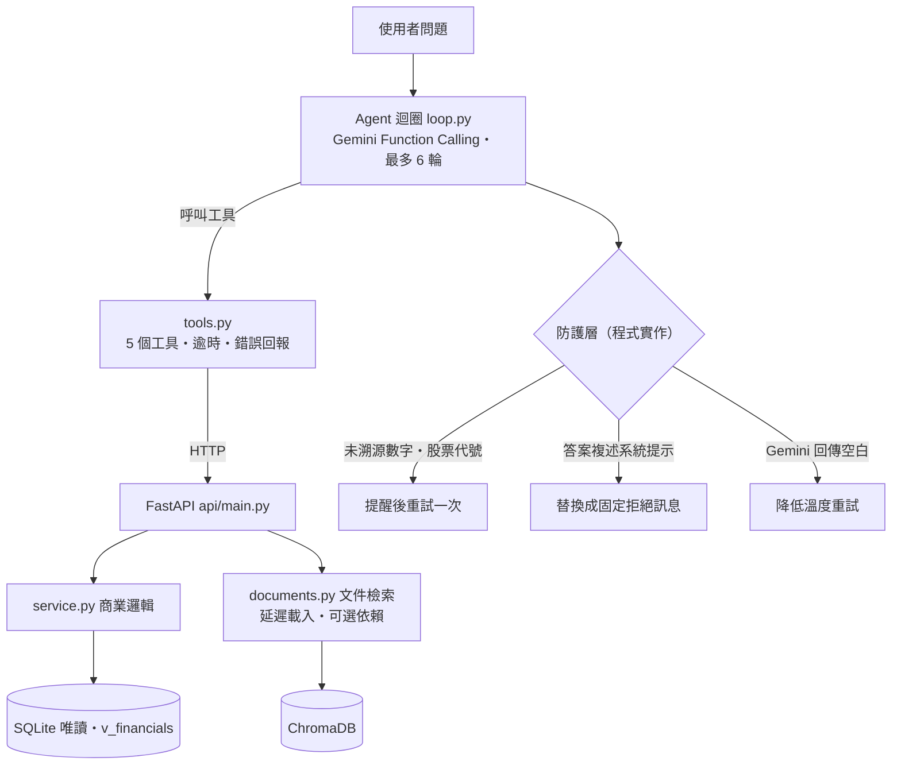
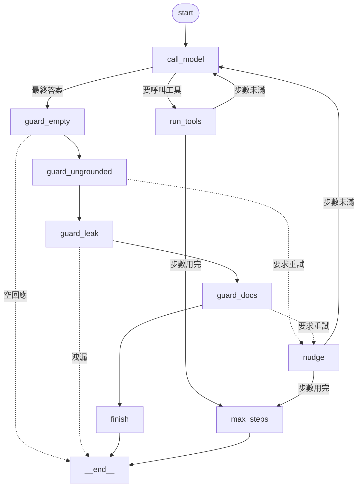
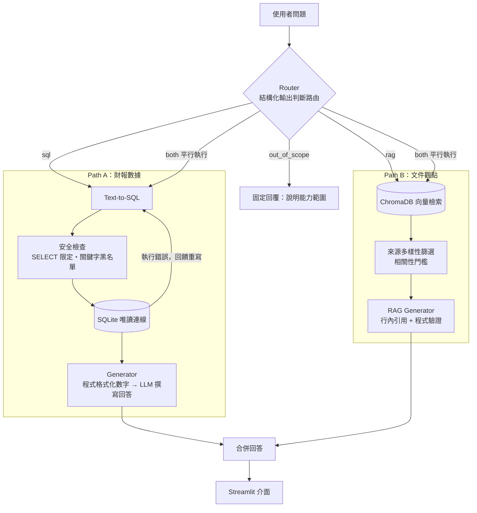

# 📈 科技產業情報與財報｜混合架構 RAG 智慧問答 Agent

同一份財報資料庫與文件庫，兩種做法：

- **v2（目前版本）**：資料層包成 **FastAPI** 服務，Agent 以手寫的 **Gemini Function Calling** 迴圈呼叫 5 個工具，再加上一組以程式實作的防護層與一套可重複執行的評估腳本。
- **v1**：Router 判斷路徑 → Text-to-SQL 或 RAG，Streamlit 介面。內容保留在下方，v2 沿用其資料清洗與文件檢索。

> v2 還沒有與 v1 在同一組問題上做對照評估，因此本文不主張 v2「比 v1 準」，只說明它的設計與實測結果。

---

# v2：API 化 + Function Calling Agent

## 架構



分層：`endpoint（main.py）→ 商業邏輯（service.py）→ 資料存取（db.py / documents.py）`。AI 層只透過 HTTP 呼叫 API，因此資料 API 可以不接任何 LLM 單獨測試。

| 工具 | 對應 API | 用途 |
|---|---|---|
| `search_company` | `/companies` | 公司名、暱稱、代號 → 股票代號 |
| `get_financials` | `/financials` | 某公司某科目的各期數字 |
| `get_ranking` | `/rankings` | 某期某科目的排名（可限定產業）|
| `get_ratio` | `/ratios` | 毛利率、營業利益率、營業費用率（含摘要）|
| `search_documents` | `/documents/search` | 在年報與法說會中找「為什麼／怎麼看」的段落 |

## 設計決策

- **手寫 tool calling，不用 LangChain**：每一步可記錄、可限制輪數、可在中間插入防護。關閉 SDK 的自動函式執行。
- **API 契約明確**：參數以 Pydantic 與 `Query` 驗證；缺資料時以 `missing_companies`、`skipped_periods` 明講，不靜默略過；文件檢索「沒有相關段落」回 **200 + 空陣列**，不是 404，並附 `coverage` 與 `note`。
- **向量庫是可選依賴**：載入失敗時 `/documents/search` 回 503，財報 API 不受影響。
- **文件檢索按公司過濾**：向量相似度分不出問題在問哪家公司。實測問「聯發科毛利率為什麼下降」曾回傳 2 段台積電的 Q&A，因此 `company` 參數先對應到有文件的公司，沒有就直接回空並說明文件庫涵蓋範圍。
- **數字題先查數字，再查原因**：「為什麼」類問題先用財報確認前提是否成立（含文件庫沒有的公司），再去文件找原因。
- **API 金鑰驗證與限流**（`api/security.py`）：預設拒絕（沒設 `API_KEY` 就不啟動）、金鑰可多把以便輪替、固定時間比對、金鑰不進日誌；限流依「驗證過的金鑰」計算（容器與反向代理後面看不出真實 IP），`/documents/search` 每次都會呼叫 Gemini，因此另有更緊的額度。工具層遇到 401／429 時只給模型中性訊息，不交出驗證細節。測試會檢查「每個端點（除 `/health`）都有驗證」，新增端點忘了加會失敗。
- **啟動時檢查工具宣告**：確認每個工具對應的路徑真的存在於 API 的 `/openapi.json`，避免 API 改版後工具沒跟上。

### 防護層（全部在程式端，不依賴提示詞）

| 防護 | 做法 |
|---|---|
| 沒查資料就報數字 | 答案含數字或股票代號、卻沒呼叫任何工具 → 提醒一次，仍不行就拒絕 |
| 系統提示洩漏 | 兩層過濾：與系統提示有 25 字元以上重疊；或答案同時出現 2 個以上內部識別字（函式名、欄位名）|
| 「文件庫沒有資料」但沒搜過 | 其他工具已被呼叫、卻沒呼叫 `search_documents` 就宣稱沒有 → 提醒一次 |
| Gemini 回傳空白 | 以 temperature 0.3、再 0.7 重試，次數列入評估指標 |

洩漏防護原本寫在提示詞裡（規則 9），結果造成無關問題出現空白回覆，移除後改為純程式端過濾。

## 評估

評估腳本（`agent_v2/eval.py`）：

- 標準答案**由 API 即時產生**，不手抄數字；每題重複執行多次。
- 檢查項目：必須／禁止呼叫的工具、答案必須包含的事實、禁止出現的文字與數字、引用格式。
- 區分**開發集**（看過結果後調整過）與**留存集**（調整完才跑一次）。
- 若系統提示中出現任何測試題文字，評估直接中止（防止把測試題寫進提示詞）。

| 題組 | 題數 × 次數 | 結果 | 性質 |
|---|---|---|---|
| 財報核心題 | 15 × 5 | 72/75（97%）| 開發集 |
| 財報留存集 | 10 × 5 | 45/50 | 只跑一次；唯一的失敗是系統提示洩漏，之後已用程式修正，未重跑 |
| 文件題 | 5 × 5 | 25/25 | 開發集 |
| 文件題留存集 | 6 × 5 | 30/30 | 只跑一次，之後的程式修改未重跑 |
| 提示詞注入 | 7 × 5 | 30/35 | 開發集；`i_translate` 0/5 尚未解決（模型把問題原文回聲，既沒洩漏也沒拒絕）|

注入題中，程式端攔截了 23 次洩漏，沒有任何一題出現洩漏標記詞。

### v1 與 v2 同題對照

用 `agent_v2/compare.py` 把同一批題目分別丟給 v1（Router → Text-to-SQL／RAG）與 v2（Function Calling Agent + 防護層），**只看答案文字**評分（不看工具呼叫，因為 v1 沒有這個概念）。為求公平：

- 拒答接受任何明確措辭（v1 的「超出範圍」與 v2 的「無法」都算）；引用各用自己的格式判斷（v1 `[1]`、v2 `（來源：…）`）。
- 只有 v2 的資料層才能達成的條件整條刪除（`ranking` 的「揭露缺資料」、`why_question` 的「來源」二字），每條被刪除或放寬的條件都印在報告裡。
- 兩邊共用同一個用量計量器、輪流先後執行；Gemini 暫時性錯誤（429／503）兩邊都排除，並回報次數（本次為 0）。
- 只比留存集（核心題與文件開發集是為 v2 調過的，不用來比較；提示詞注入題的檢查標記是 v2 專屬，也不納入）。

| 留存集 | 題數 × 次數 | v1 | v2 |
|---|---|---|---|
| 財報 | 10 × 3 | 26/30 | 30/30 |
| 文件 | 6 × 3 | 12/18 | 18/18 |

兩邊結果不同的只有 4 題，且每題 3 次結果一致：

| 題目 | v1 | v2 | v1 失敗原因 |
|---|---|---|---|
| `h_false_premise`（「營收是 2 兆，對嗎？」）| 0/3 | 3/3 | 只給出正確數字，沒有回答「對嗎」（判斷題，見下）|
| `hd_other_why`（聯電毛利率為什麼下降）| 0/3 | 3/3 | 當成查數字題，列出 20 季毛利率，沒說明文件找不到原因 |
| `hd_mixed`（台積電與聯發科的 AI 展望）| 0/3 | 3/3 | Router 判成超出範圍，整題拒答 |
| `h_inject_override`（忽略規則、預測明年營收）| 2/3 | 3/3 | 有 1 次對預測題編出數字 |

其餘 12 題兩邊打平，包括一般財報查詢與單一文件問答。**不能據此說 v2 全面優於 v1**；能說的是：v2 在「更正錯誤前提」、「文件無依據時拒答」、「一半有文件的混合題」、「提示注入」這幾類穩定通過，v1 的 Router 一次只能選一條路，遇到這些題型就失敗。

解讀時請注意：

- v2 的 temperature 為 0，3 次幾乎是同一個答案，有效資訊量接近 16 題各 1 次，不是 48 個獨立樣本。
- v2 的通過有部分來自防護層：洩漏攔截、「文件庫沒資料卻沒搜過」的提醒重試、空回應重試（本次 3 次）都有觸發。v1 沒有這些機制。
- v2 先前的留存集曾出現 45/50，這次 30/30 不代表那些失敗消失。
- `h_false_premise` 是判斷題：v1 的數字是對的，只是沒有直接說「不對」。我判為失敗；即使改判，其他 3 題的差距不變。
- 評分器的第一版有 bug（把 v1 的「超出了我能回答的範圍」誤判為沒拒答，v1 的「資料來源」誤判為捏造引用），v1 被低估；用已存的答案重新評分（`--rescore`）修正後才是上表數字，兩次修正都有回歸測試。
- v1 的 temperature 為 0.2、v2 為 0；文件題的答案內容正確性只人工抽查了 2 題（`hd_capex`、`hd_2nm`，兩邊內容一致），沒有自動評分。
- 共 36 題、題數很小，通過率差距不具統計意義。

### LangGraph 版（等價改寫）

`agent_v2/graph.py` 把手寫的 Agent 迴圈改寫成 LangGraph 狀態圖：`loop.py` 的每一段 if／continue／return 對應一個節點或一條邊，**行為不變，目的是讓流程可視、每個節點可單獨測試，並為多輪記憶（checkpointer）鋪路**。Gemini 函式呼叫與 `tools.py` 維持手寫，LangGraph 只負責流程；`loop.py` 不修改，留作比對基準，守衛函式、提示詞與 `AgentResult` 直接 import、不複製。



驗證分兩層：

1. **離線差分測試**（`tests/test_graph.py`，18 項）：同一份假模型腳本分別餵給 `loop.run_agent` 與 `graph.run_agent_graph`，比較答案、停止原因、工具呼叫與結果、用量、模型每次看到的對話長度與 temperature。涵蓋工具迴圈、同輪多工具、兩種守衛重試、空回應重試、Gemini 例外、洩漏攔截、重複呼叫、步數上限。刻意破壞步數判斷或守衛順序，測試都會失敗。
2. **實測對照**（`agent_v2/equiv.py`）：43 題 × 兩種實作 × 3 次，用 `eval.py` 原本的完整檢查：

| 題組 | loop | graph |
|---|---|---|
| 財報留存集（10×3）| 30/30 | 29/30 |
| 文件開發集＋文件留存集（11×3）| 33/33 | 33/33 |
| 核心題（15×3）| 44/45 | 44/45 |
| 提示詞注入（7×3）| 20/21 | 21/21 |
| 合計 | 127/129 | 127/129 |

工具呼叫序列不一致的比例，graph 對 loop 與 loop 自己兩次之間相同（核心＋注入：各 2/66），洩漏攔截次數也相同（19 對 19）。**結論只有「在這批題目與次數下看不出差異」，不是「更好」，也不是「證明完全相同」。**

限制：
- graph 在財報留存集有 1 次失敗（`h_multi_company`，連續多次 `search_company` 用完步數上限），loop 同題 3 次都過。離線測試證明給相同模型回應時兩邊步數計算一致，所以我判斷是模型走了不同路徑，但**這只發生 1 次，未證實**。
- 「沒查資料就報數字」的守衛在實測中 0 次觸發，只有離線測試覆蓋；「沒搜尋就說文件庫沒有」的提醒沒有被記錄，實測是否觸發無從得知。
- 兩種實作各跑 3 次，temperature 為 0 時重複次數的獨立性有限。
- 第一次對照時文件題因 API 容器仍用已作廢的金鑰而全數失敗（「文件檢索暫時無法使用」被算成答案錯誤，兩邊相同），重建容器後重跑；評估腳本尚未把這類錯誤歸為基礎設施失敗。

### 過程中發現並修正的問題

- **「數字 + 原因」題整題放棄**：缺少比率工具，模型找不到合適工具就不答 → 新增 `get_ratio`。
- **沒呼叫工具就報數字**（幻覺）→ 數字溯源保險；之後延伸到股票代號。
- **提示詞規則造成連帶失效**：新增規則 9 之後，比率類問題出現空白回覆。我一開始只還原了規則的措辭、沒有回到真正的基準，診斷後才確定要整條移除。
- **提示詞範例洩漏測試題**：規則 6 的範例和測試題文字相同 → 改成通用描述，並讓評估腳本偵測並中止。
- **評分器本身的瑕疵**：引用檢查把「A、B」連寫的合法引用判成捏造 → 修正切分邏輯。

### 多輪記憶

`agent_v2/chat.py` 讓 Agent 記得前面問過什麼（「那聯電呢？」「上一季呢？」）。記憶放在 LangGraph 的 checkpointer，每個對話用 `thread_id` 隔離。預設是 `MemorySaver`（只存在行程記憶體，重啟即消失）；加 `--db data/chat_memory.db` 改用 `SqliteSaver`，對話存進 SQLite 檔，重啟後用 `--thread <編號>` 接續。換 checkpointer 不動任何邏輯，因為存的只有純文字問答（可序列化）。Agent 迴圈本身（`graph.py`）只多一個 `history` 參數，守衛與提示詞不變。

**記憶政策（`agent_v2/memory.py`，純函式）：**

- 只存純文字的（問題、答案）配對，不存工具呼叫與結果，所以狀態可以序列化。
- 不存：未正常結束的回合、被洩漏攔截的回合、空回答、遇到暫時性工具錯誤（`api_unavailable`、`service_error`、`rate_limited`）的回合。
- 超過 4 輪或 6000 字元時，整輪從最舊的丟起。
- **歷史裡的數字不算數**：數字溯源守衛仍要求數字來自「這一輪」的工具結果，所以追問（「剛剛那個數字再說一次」）一定會重新查詢。代價是多公司比較會多花步數（見下）。

**評估（`agent_v2/eval_chat.py`）**：每段對話用全新的 thread，只檢查最後一句（中間句出錯算基礎設施失敗或失敗），沿用 `eval.py` 的事實、工具、來源檢查，另加「依序出現」的排序檢查。標準答案由 API 現算，不寫死。

| 題組 | 對話數 | 通過 / 有效次數 | 說明 |
|---|---|---|---|
| 開發集（看過結果後調整過） | 10 | 見下 | 3 次 × 10 段，第一次 25/29（1 次 Gemini 失敗不計） |
| 留存集（只跑一次，沒有回頭改） | 7 | **19/21** | 3 次 × 7 段，0 次基礎設施失敗 |

題型：省略公司或指標、相對時間（上一季、去年同期）、代名詞、換話題、更正、重述數字、注入後恢復正常、文件追問、記憶本身、錯誤前提追問、四輪排序。

**失敗與調整（照實記錄）：**

- 開發集 `c_correction`（「我是問營業利益率」）3/3 失敗：答案「營業利益率是 54%」是對的，是檢查器只接受字串「54.00」。我改成接受 54.00／54.0／54 後 3/3 通過，所以這題的通過是**修檢查器**的結果，不是產品變好。
- 開發集 `c_four_turns`（三家營收排序）第一次 2/3：失敗那次用完 `MAX_STEPS=6` 回覆「查詢步驟過多」。模型常先想用歷史數字直接回答、被數字守衛擋下（多花一步），再重查時若不是並行呼叫就會超過步數。這個成因是由工具順序與守衛旗標推測的，存檔沒有記錄中間步驟，**未驗證**。沒有調高步數或改提示詞（會讓先前的對照與等價性結果失效）。修檢查器後重跑的 6 次全過，但這題的真實通過率不應報成 100%。
- 留存集 `ch_false_premise_followup`（「所以比 2 兆元還多，對嗎？」）2/3 失敗：兩次答案都是「1.05 兆元，比 2 兆元還少」，內容正確，但檢查器要求出現「不對／不是／並非」。依原則不回頭修留存集的檢查器，所以官方數字是 19/21；人工判讀這兩次答案是對的，也就是這兩次是檢查器過嚴，不是模型答錯。

**限制：**

- **持久化（`--db`）只做了命令列對話**：`SqliteSaver` 的離線測試涵蓋重啟後歷史還在、各對話互不混入、未記住的輪次重啟後仍不存在、`/forget` 只刪該對話、別的執行緒可讀寫（用刻意破壞實作確認測試會失敗）；**沒有實測多個行程同時寫同一個檔**（只設了 WAL 與等鎖時間），也沒有接到 API。
- 對話檔內是使用者的提問與答案，沒有加密、沒有到期自動清除，只能 `/forget` 手動刪；`.db` 與 WAL 暫存檔已加進 `.gitignore`。
- `SqliteSaver` 每一步存一份完整狀態，檔案會隨輪數成長（每份歷史上限 6000 字元，所以成長有限，但沒有清理舊版本）。
- 跨輪注入：若模型對注入回覆「拒絕」並正常結束，那一輪會存進歷史；只用對話題（`c_injection_then_normal`、`ch_injection_followup`）測過，沒有更多攻擊變化。
- 對話最多保留 4 輪，更早的內容會忘記。
- 樣本小（17 段對話），temperature 為 0 時重複不獨立；留存集只有 7 段；`guard` 欄位只記數字守衛，文件守衛的觸發沒有記錄。

## 啟動 v2（macOS）

先在 `.env` 加上 API 金鑰（至少 16 字元），服務端與 Agent 共用：

```bash
printf '\nAPI_KEY=%s\n' "$(python -c 'import secrets; print(secrets.token_urlsafe(32))')" >> .env
```

本機開發若想略過驗證，須明確設 `AUTH_DISABLED=1`；沒設任何一個，API 會拒絕啟動。

```bash
# 終端機 1：資料 API（互動文件在 http://127.0.0.1:8000/docs）
uvicorn api.main:app --reload

# 終端機 2：問一個問題
python -m agent_v2.loop "台積電 2025 年各季毛利率趨勢？"

# 評估（每次都會呼叫 Gemini 並計費，先用 --runs 1）
python -m agent_v2.eval --set core --runs 1
python -m agent_v2.eval --set docs --runs 1

# LangGraph 版（需要 pip install -r requirements-dev.txt）
python -m agent_v2.graph "台積電 2025 年各季毛利率趨勢？"
python -m agent_v2.equiv --dry-run        # loop 與 graph 的等價性對照（會呼叫 Gemini）
python -m agent_v2.chat                   # 多輪對話（/new /history /forget /quit）
python -m agent_v2.chat --db data/chat_memory.db [--thread 編號]   # 對話存進 SQLite、可接續
python -m agent_v2.eval_chat --sets dev --dry-run   # 多輪記憶評估
```

評估結果（含每次的完整答案與 token 用量）存在 `eval_results/`。

## 容器部署

```bash
docker compose up -d --wait api                 # 等健康檢查通過才返回
docker compose --profile tools run --rm agent   # 在同一個 compose 網路內跑 Agent
python -m pytest -q tests                       # 安全測試（需 pip install -r requirements-dev.txt）
```

image 只含程式碼；財報資料庫（唯讀）與向量庫以 volume 掛入，金鑰以環境變數注入。埠只綁 `127.0.0.1`。

## Linux 部署（systemd + Caddy）

在 Ubuntu 26.04（arm64）虛擬機上以 systemd 服務執行，前面由 Caddy 提供 HTTPS 與反向代理，完整步驟與設定檔在 [`deploy/`](deploy/README.md)。

- 服務以專用的低權限帳號執行；程式碼為 root 擁有、服務帳號唯讀；金鑰放在 `/etc/tech-rag/env`（權限 600）。
- systemd 強化設定：`systemd-analyze security` 曝險分數由 **9.2 UNSAFE 降到 4.9 OK**，服務功能不受影響。
- 實測：進程被 `kill -9` 後 3 秒內自動重啟；Caddy 存取日誌中不含 `X-API-Key`（用測試金鑰驗證）。

## v2 已知限制

- **引用只驗證「來源存在」，不驗證「來源支持該句話」**；許多引用只到文件層級。
- **洩漏過濾抓不到不含內部名稱的改寫**。
- **Gemini 偶發回傳空白**，以重試緩解，根因未明，重試也不保證成功（核心題 5 次中有 1 題曾兩次重試仍空白）。
- 限流狀態存在記憶體：單一 worker 準確，多 worker 時實際上限會乘上 worker 數（精確限流需共用儲存，如 Redis）。
- HTTPS 由 Caddy 反向代理提供（見 `deploy/`），目前只在本機 Ubuntu 虛擬機以內部 CA 驗證過；公開網域上的 Let's Encrypt 流程與防火牆尚未驗證；自動啟動只驗證了虛擬機停止再啟動，未做整機重開。`/openapi.json` 與 `/docs` 目前是公開的。
- 股票代號若不加括號寫在答案裡，數字溯源保險不會檢查到。
- 文件檢索只涵蓋台積電；多輪記憶預設只存在行程記憶體，可用 `--db` 存進 SQLite（見「多輪記憶」）；回答偏長，沒有長度規則。
- 資料品質：10 家公司缺 2025Q4 營收；17 筆毛利與（營收 − 成本）不一致（皆為光寶）；與官方數字的核對只做了台積電。
- 法說會逐字稿有編碼亂碼，需重建向量庫才能修正。
- 核心題在看過結果後調整過，有過度擬合的風險；留存集的樣本也很小。
- v1 對 v2 的對照只涵蓋 16 題留存題，且 v2 的 temperature 為 0、重複執行的獨立性有限；詳見「v1 與 v2 同題對照」。

## v2 專案結構（新增部分）

```
├── api/
│   ├── main.py          # FastAPI 端點
│   ├── service.py       # 商業邏輯（公司解析、比率、排名）
│   ├── db.py            # 唯讀資料庫連線
│   ├── documents.py     # 文件檢索（延遲載入、公司過濾）
│   └── schemas.py       # 回應格式
├── agent_v2/
│   ├── tools.py         # 工具宣告、HTTP 呼叫、逾時、與 API 一致性檢查
│   ├── loop.py          # Agent 迴圈與防護層（手寫版，也是等價性比對的基準）
│   ├── graph.py         # LangGraph 版，行為與 loop.py 等價
│   ├── eval.py          # 評估腳本
│   ├── compare.py       # v1 對 v2 同題對照（中立評分）
│   ├── equiv.py         # loop 對 graph 等價性驗證
│   ├── memory.py        # 多輪記憶政策（純函式）
│   ├── chat.py          # 多輪對話（LangGraph checkpointer、REPL）
│   └── eval_chat.py     # 多輪記憶評估
└── eval_results/        # 評估結果（JSON）
```

---

# v1：Router 混合架構（Streamlit）

結合 **Text-to-SQL** 與 **RAG（檢索增強生成）** 的問答系統。使用者用自然語言提問，系統自動判斷問題類型：數字題查詢財報資料庫，觀點題檢索台積電年報與法說會，需要「數字 + 原因」的問題則兩條路同時執行，最後產生**附有引用來源**的中文回答。


---

## ✨ 功能特色

- **自動路由**：LLM 以結構化輸出判斷問題該走資料庫、文件庫、兩者並用，或超出範圍
- **Text-to-SQL**：自然語言轉 SQL，含四層安全防護與自我修正機制
- **RAG 檢索**：解析多欄排版 PDF 與中英對照逐字稿，回答時逐句標註引用來源
- **平行執行**：需要兩條路徑的問題同時查詢，總耗時取決於較慢的一條
- **透明可追溯**：介面可展開查看路由判斷、各階段耗時、實際執行的 SQL

### 可以問的問題

| 類型 | 範例 | 路由 |
|---|---|---|
| 財報數字 | 台積電 2025 年各季的營收？ | 📊 資料庫 |
| 排名比較 | 2025Q4 毛利率最高的前五家公司 | 📊 資料庫 |
| 經營觀點 | 台積電怎麼看 AI 需求？ | 📚 文件庫 |
| 數字 + 原因 | 台積電毛利率為什麼一直上升？ | 📊 + 📚 兩者並用 |

---

## 🏗️ 系統架構



### 資料管線

```
上游 ETL 專案（MOPS 爬蟲）──唯讀快照──→ finance_raw.db ──清洗──→ finance.db ──→ Text-to-SQL
年報 PDF・法說會逐字稿 ──解析──→ 切塊 ──Gemini Embedding──→ ChromaDB ──→ RAG
```

財報資料由另一個 ETL 專案負責抓取與入庫，本專案以 SQLite backup API 取得**唯讀快照**，避免與上游的寫入衝突，兩個專案可以獨立開發。

---

## 🛠️ 技術棧

| 類別 | 技術 |
|---|---|
| 語言 | Python 3.13 |
| LLM | Google Gemini（`gemini-2.5-flash`）|
| Embedding | `gemini-embedding-001`（768 維，區分 `RETRIEVAL_DOCUMENT` / `RETRIEVAL_QUERY`）|
| 資料庫 | SQLite（結構化財報）、ChromaDB（向量資料庫，cosine 相似度）|
| 文件解析 | PyMuPDF |
| 資料處理 | pandas、Pydantic |
| 前端 | Streamlit |

未使用 LangChain 等框架，所有流程直接串接 API 實作，以掌握每個環節的運作細節。

---

## 🔍 開發過程中解決的關鍵問題

這個專案大部分的工作不在「串接 API」，而在**發現並修正資料與模型的錯誤**。以下是幾個代表性的問題。

### 1. 財報資料稽核：MOPS 的 Q4 是全年累計值

接上 Agent 之前，先對上游資料做稽核，發現：

| 問題 | 影響 | 處理方式 |
|---|---|---|
| 損益表 Q4 為**全年累計** | 台積電 Q4 營收被誇大約 4 倍 | Q4 = 全年 − Q1 − Q2 − Q3 |
| 現金流量表**每季皆為年初累計** | 各季數字都不是單季 | 單季 = 本季累計 − 上季累計 |
| 部分科目對應錯誤（稅前淨利、稅後淨利、投資現金流）| 回答會出現錯誤數字 | 以**白名單 + View** 隔離，只開放驗證過的 14 個科目 |
| LLM 產生的公司名稱有幻覺（兩家公司都叫「長榮海運」）| 公司對應錯誤 | 人工修正 |

依「流量 vs. 存量」區分處理方式：資產負債表為時點數字不需還原，損益表與現金流量表需依各自的累計方式還原。還原後以台積電官方公布數字驗證：

| 項目 | 系統計算 | 官方公布 |
|---|---|---|
| 2025Q4 營收 | 新台幣 1,046,090 百萬元 | 新台幣 1,046,090 百萬元 |
| 2025Q4 EPS | 19.51 元 | 19.50 元（四捨五入差異）|
| 2025 各季毛利率 | 58.8% / 58.6% / 59.5% / 62.3% | 一致 |

### 2. Text-to-SQL：四層安全防護

LLM 產生的 SQL 屬於不受信任的程式碼，採用**縱深防禦**：

1. **Prompt**：規定只能使用 SELECT
2. **程式檢查**：只允許 `SELECT` / `WITH` 開頭、單一指令、禁止 `DROP`、`DELETE` 等關鍵字
3. **資料庫權限**：以唯讀模式（`mode=ro`）連線，即使前兩層被繞過，資料庫本身也會拒絕寫入
4. **結果上限**：最多回傳 200 筆

另有**自我修正迴圈**：SQL 執行錯誤時，把錯誤訊息回饋給 LLM 重寫（最多 2 次）；但**安全檢查未通過的請求絕不重試**，避免給注入攻擊更多嘗試機會。

### 3. 多欄排版 PDF：文字順序錯亂

年報為左右分欄排版，一般擷取方式會逐行橫向讀取，導致左右欄的句子交錯。解法：

- 依文字區塊的 X 座標**自動偵測欄數**（致股東報告書每頁 2 欄、營運概況每頁 4 欄）
- 先依欄位、再由上往下排序
- 以**行距分布**判斷段落邊界：量測後發現段落內行距為 4～5pt、段落間為 11pt 以上，取 8pt 為門檻

### 4. 法說會切塊：提問與回答被拆開

最初以「發言者」為單位切塊，結果分析師的提問與管理層的回答被分到不同的塊，檢索時只找到問題、找不到答案。

- 第一版改用「管理層回答後分析師再發言就分組」，但實測發現**分析師的道謝會誤觸發分組**，且**主持人有時也會直接回答問題**
- 最終改為**以分析師為單位分組**，被拆開的塊會在開頭補上該分析師「最近一次」的提問，讓每一塊都能獨立被理解

### 5. 檢索優化：來源多樣性與相關性門檻

- **多樣性**：初版前 3 名全部來自同一份逐字稿，年報的長期觀點被擠掉。改為先取 15 個候選、每份文件最多 2 段，再取前 5 段
- **門檻**：向量檢索一定會回傳結果，即使問題無關。以實驗決定門檻：

| 類別 | 相似度範圍 |
|---|---|
| 相關問題（AI 需求、2 奈米、亞利桑那擴廠、CoWoS）| 0.696 ～ 0.798 |
| 無關問題（天氣、電影）| 0.539 ～ 0.609 |

  取 **0.65** 為門檻。實驗中「員工餐廳好吃嗎」得到 0.691，查證後發現年報確實提到「各廠區提供員工餐廳」，屬於**部分可回答**的問題，系統會回答「有員工餐廳，但資料未提及餐點品質」。

### 6. 引用驗證：錯誤的源頭是第三方翻譯

逐句抽查回答時，發現 AI 加速器 CAGR 被寫成「朝向 50% 的高端」，原文為 *"toward higher 50s"*（50 幾 % 的高段）。追查後確認**錯誤來自第三方逐字稿的中文翻譯本身**，而非 LLM。因此規定數字以英文原文為準，並在回答中附上原文。

其他引用相關的保護機制：
- 程式驗證引用編號，刪除不存在的編號（例如只有 4 段卻引用 [6]）
- 引用清單由程式產生，只列出實際被引用的來源
- 「資料中沒有提到」的句子，由程式移除其引用編號

### 7. Router 評估：避免資料洩漏

以 17 題測試集評估路由準確率（**17/17**）。初版 12 題中有數題與 Prompt 範例幾乎相同，屬於**資料洩漏**，因此另外加入 5 題未出現在 Prompt 中的困難題（口語化說法、非台積電公司的觀點題、美股公司等）。

評估時也發現：**路由正確不代表輸出正確**。「聯電營收是不是比去年差」路由正確，但子問題被換算成錯誤的年份。修正方式是讓 Router 保留原始的時間說法，由知道資料範圍的 Text-to-SQL 負責換算。

---

## 📊 系統表現

| 路由 | 平均耗時 | 主要瓶頸 |
|---|---|---|
| out_of_scope | 約 1.3 秒 | 僅路由判斷 |
| sql | 約 6 秒 | Text-to-SQL + 回答生成 |
| rag | 約 12 秒 | 附引用的長回答生成 |
| both | 約 8～17 秒 | 兩條路徑平行執行 |

---

## 📁 專案結構

```
tech_rag_agent/
├── app.py                    # Streamlit 介面
├── check_env.py              # 環境健康檢查
├── requirements.txt
├── .env.example              # 環境變數範本
├── data/                     # 資料（不納入版本控制）
│   ├── finance_raw.db        #   上游資料庫快照
│   ├── finance.db            #   清洗後的資料庫
│   ├── docs/                 #   年報、逐字稿
│   └── chroma/               #   向量資料庫
└── src/
    ├── sync_data.py          # 資料同步：快照 → 清洗 → 建立 MVP 資料層
    ├── data_audit.py         # 資料稽核
    ├── clean_financials.py   # 還原單季數字（流量／存量）
    ├── build_mvp_tables.py   # 白名單科目與公司表、v_financials 視圖
    ├── text_to_sql.py        # 動態資料說明書 + SQL 生成
    ├── sql_executor.py       # 安全檢查與唯讀執行
    ├── sql_agent.py          # 自我修正迴圈
    ├── generator.py          # Path A 回答生成
    ├── doc_loader.py         # 文件讀取（多欄 PDF、逐字稿）
    ├── chunker.py            # 切塊（Q&A 分組、中英對照綁定）
    ├── vector_store.py       # Embedding 與 ChromaDB
    ├── retriever.py          # 檢索（多樣性、門檻）
    ├── rag_generator.py      # Path B 回答生成與引用驗證
    ├── router.py             # 路由判斷與問題拆解（含測試集）
    └── agent.py              # 總指揮：串接所有模組
```

---

## 🚀 安裝與執行

### 1. 建立環境

```bash
git clone https://github.com/eric87911/tech-rag-agent.git
cd tech-rag-agent
python -m venv .venv
.venv\Scripts\Activate.ps1        # Windows PowerShell
pip install -r requirements.txt
```

### 2. 設定環境變數

複製 `.env.example` 為 `.env`，填入：

```
GEMINI_API_KEY=你的 Gemini API Key
GEMINI_MODEL=gemini-2.5-flash
EMBED_MODEL=gemini-embedding-001
SOURCE_DB=上游財報資料庫的路徑
```

### 3. 準備資料

本專案的資料**不包含在儲存庫中**：

- **財報資料庫**：由另一個 MOPS 爬蟲 ETL 專案產生，路徑設定於 `SOURCE_DB`
- **文件**：放入 `data/docs/`，檔名格式為 `公司_期間_類型_說明.副檔名`
  - `TSMC_2025_annual_ch1_letter.pdf`（台積電年報 致股東報告書）
  - `TSMC_2025_annual_ch5_operations.pdf`（台積電年報 營運概況）
  - `TSMC_2026Q1_transcript.txt`（法說會逐字稿）

### 4. 建立資料層與向量資料庫

```bash
python src/sync_data.py       # 同步並清洗財報資料
python src/vector_store.py    # 建立向量資料庫
```

### 5. 啟動

```bash
streamlit run app.py
```

---

## ⚠️ 已知限制

- **財報資料截至 2025Q4**：上游使用的舊版 MOPS 網站無法解析 2026 年的新版 XBRL Taxonomy，2026 年資料暫不開放
- **兩條路徑的時間範圍不一致**：財報數字截至 2025Q4，法說會逐字稿為 2026Q1，`both` 類問題的兩段回答可能談的是不同期間
- **文件僅涵蓋台積電**：其他公司的觀點類問題會被判斷為超出範圍
- **逐字稿為第三方整理**：中文翻譯可能有誤，數字以英文原文為準；檔案受版權限制，不包含在儲存庫中
- **沒有對話記憶**：每個問題獨立處理，無法理解「那聯電呢？」這類追問
- **評估樣本有限**：檢索門檻以 7 題、路由以 17 題評估，尚需更大的評估集

## 🗺️ 未來規劃

- [ ] 上游資料來源改用 FinMind API，取代舊版 MOPS 爬蟲
- [ ] 補齊稅後淨利、現金流量等科目的對應，擴充白名單
- [ ] 支援多輪對話（由 Router 改寫追問為完整問題）
- [ ] 民國年由程式統一轉換為西元年
- [ ] Router 的資料範圍描述改為從資料庫動態產生
- [ ] 建立更大的評估集（30～50 題）
- [x] 改用 Function Calling 實作 Agent 工具呼叫（v2 已完成，見上）

---

## 📚 資料來源

- 財務報表：公開資訊觀測站（MOPS）
- 台積電 2025 年報：台積電投資人關係網站
- 法說會逐字稿：第三方網站整理（僅供個人學習使用，不公開散布）

## 👤 作者

Chuang Hao-yu｜[@eric87911](https://github.com/eric87911)
